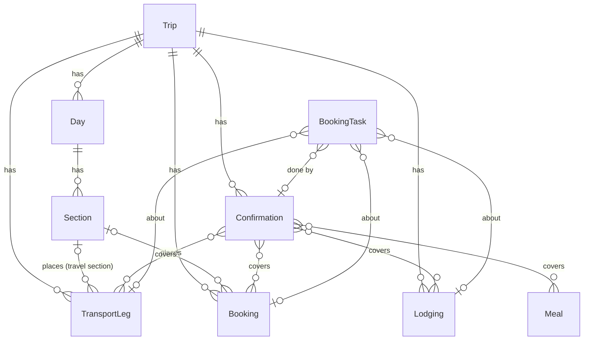

# Plan: one record per trip item, shown in two places; confirmations live with what they confirm

Status: Phases A–E done (2026-10-15, branches `phase-a-legs-in-place`, `phase-b-confirmations`,
`phase-c-convert-tables`, `phase-d-new-itineraries-as-legs`, `phase-e-booking-tasks`); Phase F planned. Hand to Claude
Code one phase per branch/PR, in order.
Read with `CLAUDE.md` → "Trips". Every decision marked **Ask James** must be answered before
the phase that depends on it.

## The problem

The trip page (e.g. trip 36, Europe 2027) shows the same hop twice:

- **"Getting there and back"** (top of the page) — `TransportLeg` rows, the trip-wide view of
  all transport.
- **A day's logistics table** — `Section(section_type="logistics_table")`, JSON rows such as
  `Butzbach → Frankfurt Hbf | RE30 | ~45 min | Frequent service`.

"Turn into legs" (`trips:section_to_legs`) copies rows into legs, but nothing links the two
afterwards: edit one and the other is stale, and the day keeps its table while the leg sits at
the top. Confirmations have the same split: `TransportLeg.confirmation_number` and
`Lodging.confirmation_number` are inline strings, while the Quick reference lists a separate,
unlinked `Confirmation` table. One Delta booking reference covering PIT→ATL→FRA has to be typed
on two legs *and* again in the list.

## The methodology (the rules every phase follows)

1. **One fact, one record.** A hop is a `TransportLeg`; a night is a `Lodging`; a reserved
   tour/ticket/table is a `Booking` (new, Phase 5) or a `Meal`; a booking reference is a
   `Confirmation`. Nothing is stored twice. Sections hold narrative and reference info only
   (what to see, how a ticket works) — never a copy of a structured item.
2. **Many views, one source.** The trip-wide lists (Getting around, Where we're staying,
   Confirmations, Still to book) and the day pages are *queries over the same records*, so they
   can't disagree. Editing from any view edits the one record.
3. **Start rough, evolve in place.** An item is created with the minimum (a leg: from, to, day;
   optionally mode and "~45 min") — as quick as typing a table row — and gains detail on the same
   record: times and zones → operator/service number → confirmation → cost. Its stage is
   *derived* from what's filled in, never a hand-set field that can drift:

   | Stage | Leg has | Shown as |
   |---|---|---|
   | Planned | from, to, date (rough duration/note optional) | "planned · ~45 min" (faint) |
   | Scheduled | + departure/arrival times | times, duration |
   | Booked | + at least one confirmation | times + confirmation chip |

   `Lodging` and `Booking` follow the same ladder (dates → details → confirmation).
4. **Confirmations attach to items.** You add a confirmation *from the item it confirms*; one
   confirmation may cover several items (a PNR covering two legs) and an item may have several
   (split party, three hotel rooms booked separately). The Quick reference list is generated
   from them, grouped and dated by the items they cover.
5. **Placement is a link, not a copy.** A day shows its items where its narrative wants them
   (under "Morning — check out and train south") through a link from the item to a section of
   that day. Items with no placement still appear on their day automatically.
6. **Never lose data in conversion.** Converting old tables links to existing matching legs
   instead of duplicating, keeps non-hop rows, and is dry-run by default.

## Target model (summary)

All new models and fields live in `trips` (layer 4); no new cross-app imports.

---

## Phase A — legs evolve in place, and the trip page shows each once in each view

**Status: done** on branch `phase-a-legs-in-place` (migration `trips 0021_leg_placement`). As built:
`TransportLeg.section` / `est_duration` / `order`, `stage` (planned/scheduled), section type
`travel` (payload form `TravelPayloadForm`), `trips/partials/_leg_row.html` in both views, the day
grouping done in Python from the existing prefetch (`views._place_legs`; `QueryCountTests` still
20 with placed and automatic legs in its fixture), `trips:leg_edit` / `leg_delete` /
`leg_quick_add` / `day_add_travel`. `logistics.rough_duration` arrived here (the quick add and edit
form need it) rather than in Phase C, which reuses it. Deviation: the quick-add and "Add travel"
controls sit in a collapsed "Add travel to this day" on days with no legs and no travel section.

Goal: the minimal-to-full lifecycle for legs, and a day shows the same leg records as the
trip-wide list.

**Model (`TransportLeg`, migration `trips 0021`):**
- `section` — FK `Section`, `null=True, blank=True, on_delete=SET_NULL`, `related_name="legs"`:
  where on its day the leg is shown. Validation (in `clean()` and enforced in `save()`): the
  section must belong to this trip and its `day.date` must equal `self.date`; if the date
  changes so it no longer matches, `save()` clears `section` (the leg then shows in its day's
  automatic block — nothing disappears).
- `est_duration` — `DurationField(null, blank)`: rough door-to-door time for planned legs
  ("~45 min"). Booked legs use the real `duration`.
- `order` — `PositiveSmallIntegerField(default=0)`: sequence among same-day legs with no times
  (Butzbach→Frankfurt before Frankfurt→Augsburg). Meta ordering becomes
  `["trip", "date", F("departure_at").asc(nulls_last=True), "order", "id"]`.
- `stage` property (`planned` / `scheduled` / `booked`), per the table above. `booked` needs
  Phase B; until then it's planned/scheduled.
- `day` property resolved from a `{date: Day}` map the view passes in (no FK: the date already
  says which day, and an FK could disagree with it).

**Section type `travel` (no schema change; new `Section.Type` choice + migration for the
choice):** "this day's legs go here". Payload: `{"intro": str?, "columns": [...]?,
"rows": [[...]]?}` — `rows` are the leftover *non-hop* reference rows (Bayern Ticket price,
"what it covers", U4/U5 to Theresienwiese). Rendering: title, then its legs (`section.legs`,
ordered) as table rows in the leg row partial, then the reference rows. To the reader it looks
like the old logistics table; every hop row is now a live leg.

**Rendering:**
- `trips/partials/_leg_row.html` — one leg as a table row/compact card: mode icon, `A → B`,
  operator + service number, times *or* "planned · ~45 min", stage badge, notes; for editors an
  "Edit" link. Used by both views so they can't drift.
- **Trip-wide "Getting around"** (replaces "Getting there and back"): every leg of the trip in
  order, one row each, with "Day N" linking to `#day-N`. Planned legs included (faint). Legs
  whose date matches no day are flagged for editors ("not on any day — check the date").
- **Day:** each `travel` section renders its legs in place; legs on that date with no section
  render in an automatic "Getting around" block at the top of the day (e.g. Day 1's flights).
  The day block shows a total when every leg has a duration or estimate ("2 legs · ~3 h 15 min").
- Query budget: legs come from the already-prefetched `trip.transport`; the view groups them by
  date and by `section_id` in Python. **No new queries.** `QueryCountTests` stays at 20.

**Editing, from either view:**
- Per-leg edit page `trips:leg_edit` (`/trips/<pk>/legs/<leg_pk>/`), grouped: Route (from/to,
  cities, mode) · Schedule (date, local times, zones, `est_duration`) · Details (operator,
  service number, cost, notes) · Placement (section, choices = `travel` sections of the leg's
  day). Delete with confirm. Editors only (`Trip.can(user, "edit")`, 404/403 as usual). The
  trip edit page's Transport formset keeps working (it's the bulk view).
- Quick add on a day: an inline one-line form under each `travel` section and the automatic
  block — From, To, Mode, ~Duration, Note — creating a planned leg with `date=day.date` and
  `section` set. This is "typing a table row", but it makes a leg.
- "Add travel" on a day with no `travel` section creates one (title "Getting around").

**Tests:** stage derivation; section/date mismatch clears `section`; a leg renders once in the
trip list and once on its day (in its section, or the automatic block); planned-leg ordering by
`order`; quick add creates a planned leg on the right day; edit page permissions (viewer 404/403,
editor OK); detail query count unchanged; non-UTC user renders leg times correctly (the
`|at_zone` rule).

## Phase B — confirmations attached to items, Quick reference generated

**Status: done** on branch `phase-b-confirmations` (migrations `trips 0022`–`0024`; tests in
`apps/trips/tests/test_confirmations.py`). As built: `Confirmation.attach_number` is the one
link-or-create rule (migration 0023 carries a copy, as migrations must); stays and meals have no
edit page of their own, so they are attached from the confirmation's page (`?stay=` pre-ticks)
rather than from a stay/meal edit block; the leg edit page has the attach/detach block. Tours &
tickets is not a group yet (nothing models a tour); no standalone `trips:trip_confirmations` page.
Query pin 20 → 24 (`confirmations__legs`, `__stays`, `__meals`, `__travelers`), instead of
prefetching from the items' side. Dev check on Taos: GCH7JS is one confirmation covering the four
Delta legs (all Booked), Hotel Chimayo linked, Angel Fire's second number its own stay confirmation.

**Model (`trips 0022`–`0024`, hand-written: schema / data / drop, because of the Postgres
"index after data change in one transaction" problem noted in CLAUDE.md):**
- `Confirmation` gains: `legs` M2M `TransportLeg` (`related_name="confirmations"`), `stays` M2M
  `Lodging` (`related_name="confirmations"`), `meals` M2M `Meal` (`related_name="confirmations"`),
  `travelers` M2M `Traveler` (blank = everyone on the items), `url` (manage-booking link,
  optional), `booked_on` (date, optional), `cost` + `currency` (optional; total for the booking,
  so a PNR's price isn't split across legs). `label` becomes optional (defaults to a description
  of what it covers). `travelers` is in Phase B (**decided 2026-10-15**: yes, for split groups).
- Data migration: every non-empty `TransportLeg.confirmation_number` / `Lodging.confirmation_number`
  is **linked to the trip's existing `Confirmation` with the same number** (compared trimmed,
  case-insensitive) when there is one, and only otherwise becomes a new `Confirmation` (provider =
  leg operator / stay name), deduplicated per trip by number so a PNR typed on two legs becomes one
  confirmation covering both (**decided 2026-10-15**). Real case, Taos (trip 30): GCH7JS is on four
  Delta legs *and* already in Quick reference as "Flights (Delta, all 4 legs)" — the migration links
  that one confirmation to the four legs instead of creating a second; Hotel Chimayo's 5305434791
  links to "Hotel Chimayo, Santa Fe". Numbers that differ (Angel Fire stay "Reservation-1216125" vs
  the list's "EVRN0002048844001") stay two confirmations, both shown, for James to tidy. Loose
  confirmations with no matching item (Hertz, Allianz insurance) stay loose. Then drop both inline
  columns (**decided 2026-10-15**: drop).
- `BookingTask.confirmation` stays.

**Editing (item-first):** on the leg edit page, stay edit, and meal edit, a "Confirmation" block:
attach an existing confirmation of this trip (picker shows number + what it already covers) or
create one (number, provider, url, notes). Detach without deleting. On the confirmation's own
edit page, tick which legs/stays/meals it covers. Loose confirmations (travel insurance, rail
pass) can still be added from the Quick reference.

**Rendering:**
- Item views show a confirmation chip (number + provider) — once per item, both views.
- **Quick reference → Confirmations** is generated: each confirmation once, grouped Flights /
  Trains / Stays / Tours & tickets / Meals / Other (by the items it covers), ordered by the
  first covered item's date, showing what it covers ("PIT→ATL, ATL→FRA · Fri Sep 17"), who, and
  the link. Loose ones last. Optional standalone printable page `trips:trip_confirmations`.
- Query budget: +2–3 queries (prefetch `transport__confirmations`, `lodging__confirmations`,
  `confirmations__legs`/`__stays` — pick the smallest set that renders both views). Raise the
  `QueryCountTests` pin deliberately with a comment saying why; don't let it creep silently.

**Public view / audit:** confirmations stay out of `public.py`. Update `audit_public_leak`
(`public.py` reads `confirmation_number` from legs and stays today) to read numbers from
`trip.confirmations`. Update the docx importers and `import_itinerary` to create `Confirmation`
rows linked to the items instead of setting the dropped fields.

**Tests:** migration dedup (two legs, same number → one confirmation covering both); attach/detach
from a leg; quick-reference grouping and ordering; leg `stage` becomes `booked`; audit still exits
1 on a planted number; admin still lists confirmations.

## Phase C — convert existing logistics tables into linked legs (whole trip at once)

**Status: done** on branch `phase-c-convert-tables` (no migrations; `apps/trips/travel_tables.py`,
tests in `test_travel_tables.py`). As built: the row reader got stricter first — on the real data
the word "to" made Taos's day schedules look like hop tables ("Continue to Angel Fire", "Via Hwy 503
→ Hwy 76"), so each hop has a `strength` and only arrow rows are ticked or raise the banner; a
leading verb is dropped so "Depart ABQ → SLC" links to the ABQ→SLC leg; matching also accepts each
end naming the other's. The per-section page lost its "remove converted rows" box (conversion always
removes them). `rough_duration` already existed from Phase A. Query pin unchanged at 24. Dev dry
runs: trip 36 links Sep 20's two legs and creates 6 (Sep 21, 25, 28), skipping the hire-car and
LHR-options tables; Taos only links the two flight-home legs.

The per-section "Turn into legs" page stays, but changes behaviour, and a trip-wide version is
added so a 17-day trip is one review, not 17.

- **Trip-wide review** `trips:trip_travel_review` (editors), linked from a banner on the trip
  page when any `logistics_table` section still has "A → B" rows: every proposed hop from every
  table, grouped by day, in one formset (reuse `LegProposalForm` + a hidden `section` id).
- **Match before create:** for each proposed row, look for an existing leg on that date with the
  same wording or the same city pair (the matching already in `section_to_legs`). A match is
  shown as "Link to existing leg" (ticked) — confirming *links* it (sets `leg.section`, fills an
  empty `est_duration`/notes/operator from the row, never overwrites) instead of creating a
  duplicate. No match → "Create planned leg" (ticked). Trip 36's already-converted Sep 20 and
  Sep 21 legs get linked, not doubled.
- **On confirm, per section:** the section becomes type `travel` (title kept); converted rows and
  matched rows are removed from its `rows`; "Total…" rows are dropped (the day total is computed
  now), with any non-time text from them appended to the last leg's notes; remaining rows stay as
  reference rows. A section left with no rows and no legs is deleted. Nothing is saved before
  confirming; times are never guessed (`est_duration` comes from "~45 min", "~2.5 hrs",
  "~1 hr 15 min" via a new pure `logistics.rough_duration(text)`).
- **Command** `manage.py convert_travel_tables --trip <pk> [--apply]` doing the same with the
  automatic choices (dry run prints the plan; unmatched city names reported, left blank).
- The per-section page gets the same link-or-create logic and the same "becomes a `travel`
  section" result.

**Tests:** `rough_duration` parsing; link-not-duplicate on an existing leg; a Bayern-Ticket-style
table keeps its info rows and gains the leg; totals dropped; dry run saves nothing; idempotent
second run finds nothing to do.

## Phase D — new itineraries start as legs

**Status: done** on branch `phase-d-new-itineraries-as-legs` (no migrations; tests in
`test_import_legs.py`). As built, the conversion runs in `import_itinerary` (after the trip, its
legs and days are written, same transaction) rather than in the pure parsers: only there can a row
link to the document's own scheduled flight (Taos's "Depart ABQ → SLC") and match catalogue
cities, so imports reuse Phase C's `travel_tables` with its automatic choices. `--keep-tables`
skips it; the dry run lists the hops. The travel section editor (intro + reference rows) already
existed from Phase A; it now lists the section's legs with Edit links and the quick add, and a
logistics table with arrow rows links to "Turn into legs". Query pin unchanged at 24.

- `docx_import` / `docx_europe`: hop rows become planned legs placed in a `travel` section
  (reusing `logistics.proposed_legs` + `rough_duration`); the rest of the table stays as
  reference rows. Old `logistics_table` stays a valid type for tables that aren't travel.
- Section edit form for `travel`: edits intro and reference rows; legs are edited as legs.

## Phase E — booking tasks point at what they're about

**Status: done** on branch `phase-e-booking-tasks` (migration `trips 0025_booking_task_items`; logic in
`apps/trips/booking_tasks.py`; tests in `test_booking_tasks.py`). Decisions (2026-10-15): **offer**,
don't auto-tick; **yes** to the derived "Not booked yet" list; existing tasks are **suggested, James
confirms** (no data migration). As built: `booking` waits for Phase F; suggestions match a stay by
name or a leg by the first word of each end, only when exactly one item matches, editors only, with
"Not this one" remembered as a "Not about: …" line in the task's notes. On dev, Europe's tasks
suggest exactly the three hotels and the ICE leg. Query pin unchanged at 24.

- `BookingTask` gains optional `leg`, `stay`, `booking` (Phase F) FKs, `SET_NULL`, at most one
  set (`CheckConstraint`). "ICE seats Frankfurt→Augsburg" points at that leg.
- The item views show its open tasks ("still to book: seats for 6"); the Still to book list shows
  the item and its day.
- When an item gets its first confirmation, its open tasks are offered for ticking off ("Mark
  'ICE seats…' done?"). **Ask James:** offer, or tick automatically?
- Optional derived list: items whose mode/kind usually needs booking (flights, ICE, stays, timed
  entries) with no confirmation and no task — shown under Still to book as "Not booked yet", so
  nothing needs a hand-typed task just to be remembered. **Ask James** whether he wants this or
  prefers tasks only.

## Phase F — `Booking` for everything else you reserve

Tours, timed entries, tickets, passes, car hire, an Oktoberfest tent table: today they're prose in
sections plus a booking task, with nowhere to put the confirmation.

- `Booking`: `trip`, `date`, `end_date?`, `start_time?` (local, with the day's zone), `kind`
  (tour / entry / ticket-pass / table / car hire / other), `title`, `provider`, `poi` (optional FK
  `locations.POI` — trips may import locations), `place_text`, `travelers` M2M (blank = everyone),
  `est_cost` + `currency`, `notes`, `section` (placement, same rules as legs), `order`. Same
  derived stage ladder. Covered by `Confirmation.bookings` M2M.
- Rendered in place on its day (via `section`) or in the day's automatic block, and in a
  trip-wide "Reservations" list; confirmations appear in Quick reference automatically.
- `Meal` gains optional `reserved_at` (time) so a booked dinner (Fat Duck) shows its time and
  confirmation; unreserved meals stay recommendations.
- Never in the public view; add to `audit_public_leak` checks.

## Later (same pattern, not planned in detail)

- **Stays on days:** each day header shows "Staying: <Lodging>" (check-in ≤ date < check-out),
  "Check in"/"Check out" on the first/last day — derived from `Lodging`, so the day narrative
  needn't repeat the hotel.
- **Legs' travellers:** optional `TransportLeg.travelers` (blank = the day's roster) for split
  groups (Sara & Henry MUC→PIT).
- **Costs:** a confirmation's `cost` can create/suggest a `TripExpense`.

## Open decisions (Ask James)

1. ~~Drop the inline `confirmation_number` columns after migrating?~~ **Drop** (2026-10-15).
2. ~~`Confirmation.travelers` in Phase B, or later?~~ **Phase B** (2026-10-15).
3. ~~Booking tasks: auto-tick vs offer?~~ **Offer** (2026-10-15).
4. ~~Derived "Not booked yet" list?~~ **Yes** (2026-10-15).
5. ~~Phase F before or after E?~~ **After** (E done first).

## Done means

- Each leg, stay, booking and confirmation exists once; the trip-wide list and the day show the
  same records; editing from either updates both.
- A new hop can be added from a day as quickly as typing a table row, and grows into a booked leg
  with a confirmation on the same record.
- The Quick reference confirmation list is generated from item-attached confirmations.
- `check_layers.py` clean, full suite green, `audit_public_leak` 0, `QueryCountTests` pin changed
  only where a phase says so.
- `CLAUDE.md` "Trips" updated at the end of each phase (models, rendering partials, the rules
  above).
